# Hướng dẫn GitHub và CI/CD cho dự án To-do (Nhóm 3, Đề tài 24)

Tài liệu này viết cho người **chưa từng dùng Git**. Làm theo từng bước là tự đẩy được code lên GitHub, chạy được CI/CD với GitHub Actions và triển khai lên Render. Mỗi bước có bốn phần: làm gì, lệnh hoặc chỗ bấm, kết quả đúng, và ảnh cần chụp (ký hiệu 📸). Mọi lệnh dùng cho Windows PowerShell. Số liệu và tên run trong tài liệu là số thật đo ngày 26/10/2026 (xem `thi-nghiem.md`).

## Bắt đầu nhanh

Dành cho người đã quen một chút, chỉ cần các lệnh chính. Mỗi dòng có phần giải thích chi tiết ở mục ghi bên phải.

```powershell
# 1. Cài công cụ (mục 1). Nếu winget báo không tìm thấy gói, cài từ trang chủ của từng công cụ.
winget install Git.Git; winget install GitHub.cli; winget install Python.Python.3.12
# 2. Khai báo tên và email ĐÚNG với tài khoản GitHub của bạn (mục 1)
git config --global user.name "Họ Tên"; git config --global user.email "email-dang-ky-github"
gh auth login                                    # đăng nhập GitHub (mục 1)
# 3. Lấy code và chạy thử (mục 3)
gh repo clone 233404050154-NguyenHuuAn/project_24; cd project_24
python -m venv .venv; .venv\Scripts\Activate.ps1; pip install -r requirements-dev.txt
flake8; pytest                                   # phải thấy "76 passed"
flask --app app run --debug                      # mở http://127.0.0.1:5000, Ctrl+C để dừng
# 4. Một lần làm việc hoàn chỉnh = một nhánh = một PR (mục 3)
git switch main; git pull; git switch -c docs/ten-viec
#    ... sửa file ...
git add .; git commit -m "docs: mô tả ngắn"; git push -u origin docs/ten-viec
gh pr create --base main --title "docs: mô tả ngắn" --body "Làm gì và vì sao"
gh pr checks --watch                             # chờ CI xanh
gh pr merge --merge --delete-branch; git switch main; git pull
```

Gặp lỗi: xem mục 4. Muốn hiểu vì sao làm vậy: đọc mục 5 đến 9.

## Mục lục

0. [Đọc trước](#0-đọc-trước)
1. [Cài công cụ và cấu hình](#1-cài-công-cụ-và-cấu-hình)
2. [Tạo repo, mời thành viên, clone](#2-tạo-repo-mời-thành-viên-clone)
3. [Quy trình làm việc hằng ngày](#3-quy-trình-làm-việc-hằng-ngày)
4. [Lỗi thường gặp](#4-lỗi-thường-gặp)
5. [Ruleset bảo vệ nhánh main](#5-ruleset-bảo-vệ-nhánh-main)
6. [Đọc tab Actions](#6-đọc-tab-actions)
7. [Render: tạo Web Service](#7-render-tạo-web-service)
8. [Secrets và Variables](#8-secrets-và-variables)
9. [Luồng CI/CD đầy đủ](#9-luồng-cicd-đầy-đủ)
10. [Kịch bản từng thí nghiệm](#10-kịch-bản-từng-thí-nghiệm)
11. [Bảng ảnh chụp](#11-bảng-ảnh-chụp)
- [Phụ lục A: JSON ruleset](#phụ-lục-a-json-ruleset)
- [Phụ lục B: giải thích file workflow](#phụ-lục-b-giải-thích-file-workflow)
- [Phụ lục C: bảng lệnh nhanh](#phụ-lục-c-bảng-lệnh-nhanh)

## 0. Đọc trước

**Thông tin dự án**

| Mục | Giá trị |
|---|---|
| Repo | https://github.com/233404050154-NguyenHuuAn/project_24 |
| Ứng dụng đang chạy | https://project-24-x8jl.onrender.com (Render Free, có thể chờ khoảng 22 giây ở lần mở đầu sau khi ngủ) |
| Ứng dụng | Quản lý công việc hằng ngày (Flask), `APP_VERSION` đặt trong `app.py` |
| Pipeline | `.github/workflows/ci-cd.yml`: Lint, Test (Python 3.10, 3.11, 3.12), Deploy |
| Số liệu thí nghiệm | `docs/thi-nghiem.md` |
| Ảnh minh chứng | `docs/minh-chung/` |
| Video demo | [Xem video](https://drive.google.com/file/d/1kUIelZABz_gtzm_IreyU2uQ35SYCu4WR/view?usp=sharing) |

**Vai trò trong nhóm**

| Thành viên | Vai | Phụ trách chính |
|---|---|---|
| Ngô Ngọc Ánh | Lý thuyết | CI/CD, DevOps, GitHub Actions, PaaS và Render, so sánh công cụ, tài liệu tham khảo |
| Nguyễn Hữu An | Thực hành | Repo, ứng dụng, pipeline, Render, thí nghiệm, minh chứng |
| Nguyễn Thị Thanh Hồng | Báo cáo và truyền đạt | Báo cáo, slide, nhất quán giữa lý thuyết và thực hành, phản biện, phiếu phân công |

**Công cụ và phiên bản dùng trong dự án:** Git 2.56.0, GitHub CLI (`gh`) 2.103.2, Python 3.12.10 trên máy; CI chạy Python 3.10, 3.11, 3.12.

**Quy ước trong tài liệu**
- 📸 là chỗ cần chụp ảnh. Chụp cả thanh địa chỉ của trình duyệt, zoom 100 đến 125%, che mọi giá trị bí mật. Tên file đúng như bảng ở mục 11, lưu vào `docs/minh-chung/`.
- Lệnh trong khung `powershell` chạy trong PowerShell. Lệnh làm việc với repo phải chạy **trong thư mục `project_24`** (thư mục có file `app.py`).
- `<...>` là chỗ bạn thay bằng giá trị của mình, không gõ dấu `<` `>`.
- Nhánh chính tên `main` bị khoá (mục 5): không ai đẩy thẳng lên `main` được, mọi thay đổi đi qua nhánh và Pull Request (PR).

## 1. Cài công cụ và cấu hình

### 1.1 Cài Git, Python, GitHub CLI

**Làm gì:** cài ba công cụ. Git quản lý lịch sử code, Python chạy ứng dụng và test, `gh` (GitHub CLI) cho phép làm việc với GitHub ngay trong PowerShell.

**Lệnh:**

```powershell
winget install Git.Git
winget install GitHub.cli
winget install Python.Python.3.12
```

Nếu `winget` không có hoặc báo không tìm thấy gói, tải từ trang chủ: git-scm.com, cli.github.com, python.org. Khi cài Python bằng trình cài đặt, tích ô "Add python.exe to PATH". **Đóng PowerShell và mở lại** sau khi cài.

**Kết quả đúng:**

```powershell
git --version      # git version 2.56.0.windows.3 (hoặc mới hơn)
gh --version       # gh version 2.103.2 (hoặc mới hơn)
python --version   # Python 3.12.x
```

### 1.2 Khai báo tên và email (rất quan trọng)

**Làm gì:** cho Git biết bạn là ai. Mỗi commit lưu tên và email này.

```powershell
git config --global user.name "Họ Tên của bạn"
git config --global user.email "email-ban-dung-dang-ky-github"
git config --global core.editor notepad
```

**Vì sao quan trọng:** GitHub gán commit cho tài khoản của bạn dựa trên **email** ghi trong commit. Nếu email không trùng với email đã thêm vào tài khoản GitHub, commit vẫn có nhưng **không tính vào tài khoản của bạn** (không có ảnh đại diện, không vào danh sách đóng góp). Điểm cá nhân của mỗi thành viên dựa trên minh chứng như lịch sử commit, nên email sai có thể làm mất minh chứng của chính bạn. Kiểm tra email trên GitHub tại Settings → Emails.

Ví dụ thật trong repo: commit viết trên máy An mang tên `Nguyen Huu An` (theo `git config`), còn commit merge do nút Merge trên GitHub tạo ra mang tên tài khoản `NguyenHuuAn`. Hai tên khác nhau nhưng cùng một người, do hai nơi tạo commit khác nhau.

Dòng `core.editor notepad` đặt trình soạn thảo mặc định là Notepad. Mặc định của Git là Vim, rất khó thoát với người mới (xem mục 4).

**Kiểm tra:**

```powershell
git config --global user.name
git config --global user.email
```

### 1.3 Cho phép kích hoạt môi trường ảo Python

**Làm gì:** PowerShell mặc định chặn chạy script `Activate.ps1`. Cho phép chạy script do chính bạn tạo, chỉ cho tài khoản Windows hiện tại:

```powershell
Set-ExecutionPolicy -Scope CurrentUser RemoteSigned
```

**Kết quả đúng:** `Get-ExecutionPolicy -Scope CurrentUser` trả `RemoteSigned`.

### 1.4 Đăng nhập GitHub bằng `gh`

```powershell
gh auth login
```

Chọn: GitHub.com → HTTPS → Login with a web browser. Lệnh in một **mã một lần** (dạng `9A8A-28B4`) và mở trang https://github.com/login/device. Dán mã vào trang đó và bấm Authorize.

**Kết quả đúng:** `gh auth status` in `Logged in to github.com account <tên-tài-khoản>`.

**Một lỗi dễ gặp:** khi đẩy file nằm trong `.github/workflows/` mà `gh` chưa có quyền `workflow`, GitHub từ chối với thông báo `refusing to allow an OAuth App to create or update workflow ... without workflow scope`. Cấp thêm quyền:

```powershell
gh auth refresh -h github.com -s workflow
```

Làm theo mã một lần như lúc đăng nhập. Nhóm gặp lỗi này khi thêm workflow đầu tiên.

Nếu `git push` hỏi tên đăng nhập hoặc báo `could not read Username`, chạy `gh auth setup-git` một lần để Git dùng chung đăng nhập của `gh`.

## 2. Tạo repo, mời thành viên, clone

### 2.1 Tạo repo

**Cách 1, bằng lệnh** (đã dùng trong dự án), chạy trong thư mục muốn chứa repo:

```powershell
gh repo create project_24 --public --description "Nhóm 3 – Đề tài 24: CI/CD với GitHub Actions" --add-readme --gitignore Python --clone
```

Lệnh tạo repo công khai có sẵn README và `.gitignore` mẫu cho Python, rồi clone về máy vào thư mục `project_24`.

**Cách 2, trên web:** GitHub → dấu `+` ở góc phải → New repository → đặt tên, chọn Public, tích Add a README và chọn `.gitignore` template Python → Create repository.

**Kết quả đúng:** mở https://github.com/233404050154-NguyenHuuAn/project_24 thấy trang repo với README và một commit đầu tiên tên "Initial commit".

📸 `01_repo-moi.png`: trang chủ repo vừa tạo.

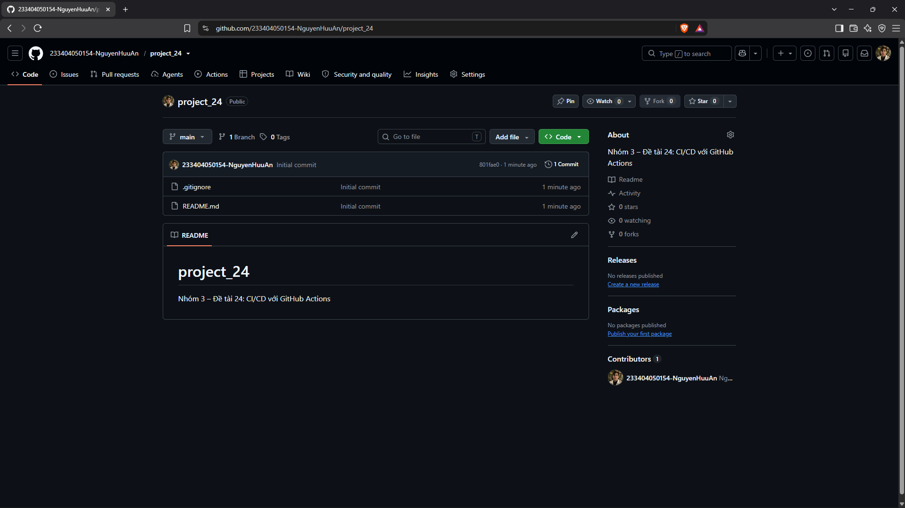

### 2.2 Mời thành viên

**Cách 1, bằng lệnh** (chủ repo chạy):

```powershell
gh api -X PUT repos/233404050154-NguyenHuuAn/project_24/collaborators/<ten-tai-khoan> -f permission=push
```

**Cách 2, trên web:** repo → Settings → Collaborators → Add people → nhập tên tài khoản → Add.

Người được mời mở https://github.com/233404050154-NguyenHuuAn/project_24/invitations và bấm **Accept invitation**. Kiểm tra danh sách:

```powershell
gh api repos/233404050154-NguyenHuuAn/project_24/collaborators --jq '.[].login'
```

Ngày 26/10/2026 repo có ba người: `233404050154-NguyenHuuAn`, `233404050159-NgoNgocAnh`, `233404050173-ThanhHong`.

### 2.3 Clone repo về máy

```powershell
gh repo clone 233404050154-NguyenHuuAn/project_24
cd project_24
```

(Hoặc `git clone https://github.com/233404050154-NguyenHuuAn/project_24.git`.) **Kết quả đúng:** có thư mục `project_24` chứa `app.py`, `tests`, `templates`, `static`, `docs`, `.github`.

## 3. Quy trình làm việc hằng ngày

Quy tắc xuyên suốt: **một việc = một nhánh = một PR**. Không sửa trực tiếp trên `main`. Nhánh `main` luôn chạy được và đã qua kiểm tra.

### 3.1 Chạy ứng dụng và test trên máy (làm một lần đầu)

```powershell
python -m venv .venv                      # tạo môi trường ảo, thư mục .venv
.venv\Scripts\Activate.ps1                # kích hoạt (mỗi PowerShell mới phải làm lại)
pip install -r requirements-dev.txt       # cài thư viện
flake8                                    # kiểm tra kiểu code, không in gì là sạch
pytest --cov=app --cov=validators --cov-report=term-missing
```

**Kết quả đúng:** `76 passed`, bảng coverage hiện `TOTAL ... 100%`.

📸 `02_pytest-xanh.png`: terminal chạy `flake8` rồi `pytest`, thấy số test đạt và coverage 100%.

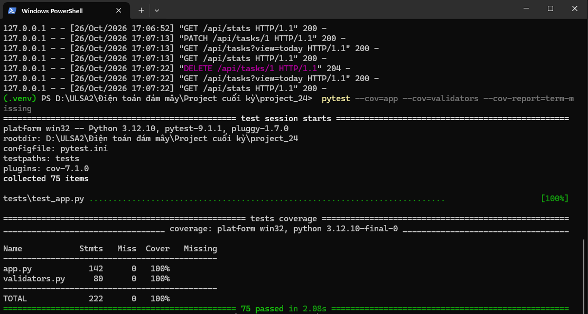

Chạy ứng dụng:

```powershell
flask --app app run --debug
```

Mở http://127.0.0.1:5000. Dừng bằng `Ctrl+C`. Gunicorn không chạy trên Windows nên trên máy dùng `flask run`; Render mới dùng Gunicorn.

📸 `03_app-local.png`: app chạy local, thấy huy hiệu phiên bản (ví dụ `v1.1.0`) ở góc.

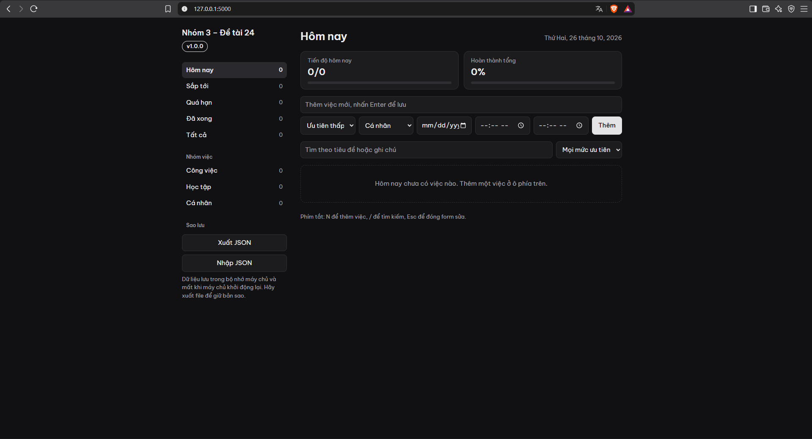

Nếu PowerShell chặn `Activate.ps1`, hoặc muốn khỏi kích hoạt, gọi thẳng `.venv\Scripts\python -m pytest`.

### 3.2 Một vòng làm việc bằng lệnh

Giả sử muốn sửa một file tài liệu.

**Bước 1. Về `main` và cập nhật** (luôn làm trước khi tạo nhánh mới):

```powershell
git switch main
git pull
```

**Kết quả đúng:** `Already up to date.` hoặc danh sách file vừa kéo về.

**Bước 2. Tạo nhánh mới và chuyển sang:**

```powershell
git switch -c docs/ten-viec
```

Tên nhánh nên có tiền tố giống kiểu commit (`feat/`, `fix/`, `docs/`...) và mô tả việc. **Kết quả đúng:** `Switched to a new branch 'docs/ten-viec'`.

**Bước 3. Sửa file** bằng trình soạn thảo bạn thích. Xem những gì đã đổi:

```powershell
git status
git diff
```

**Bước 4. Chọn file đưa vào commit và ghi commit:**

```powershell
git add docs/ten-file.md
git commit -m "docs: mô tả ngắn việc đã làm"
```

Quy ước đầu dòng của thông điệp commit:

| Đầu dòng | Dùng khi |
|---|---|
| `feat:` | thêm tính năng |
| `fix:` | sửa lỗi |
| `test:` | thêm hoặc sửa test |
| `ci:` | sửa pipeline, workflow |
| `docs:` | sửa tài liệu |

Ví dụ thật trong repo: `ci: thêm job deploy lên Render và smoke test`, `test: kiểm tra file tĩnh trong trang chủ trả 200`, `docs: ghi kết quả thí nghiệm 1 (deploy) và thí nghiệm 2 đến 6`.

**Bước 5. Đẩy nhánh lên GitHub:**

```powershell
git push -u origin docs/ten-viec
```

**Kết quả đúng:** thấy dòng `* [new branch] docs/ten-viec -> docs/ten-viec`.

**Bước 6. Mở Pull Request (PR)** để xin đưa nhánh vào `main`:

```powershell
gh pr create --base main --title "docs: mô tả ngắn" --body "Làm gì và vì sao"
```

**Kết quả đúng:** lệnh in đường dẫn PR, dạng `https://github.com/233404050154-NguyenHuuAn/project_24/pull/<số>`.

**Bước 7. Chờ CI chạy xong:**

```powershell
gh pr checks --watch
```

**Kết quả đúng:** các dòng `Lint (flake8)` và ba dòng `Test (Python 3.10/3.11/3.12)` đều `pass`, mỗi job mất khoảng 10 đến 20 giây. Ví dụ thật của PR #7:

```
Lint (flake8)        pass   11s
Test (Python 3.10)   pass   18s
Test (Python 3.11)   pass   11s
Test (Python 3.12)   pass   14s
```

Mỗi job hiện hai lần (một lần cho sự kiện `push`, một lần cho `pull_request`), đây là bình thường vì workflow chạy theo cả hai sự kiện.

**Bước 8. Merge khi tất cả xanh:**

```powershell
gh pr merge --merge --delete-branch
```

`--merge` tạo commit merge, `--delete-branch` xoá nhánh trên GitHub sau khi xong. Nếu CI chưa xanh, lệnh bị từ chối (xem mục 4).

**Bước 9. Về `main` và kéo bản mới:**

```powershell
git switch main
git pull
```

Từ đây quay lại bước 1 cho việc tiếp theo. **Không tạo nhánh mới từ một `main` cũ**, vì nhánh đó có thể thiếu file workflow hoặc thiếu thay đổi của người khác.

📸 `04_actions-ci-xanh.png`: trang run trong tab Actions, thấy sơ đồ Lint → ba Test, đều xanh, có thời gian.

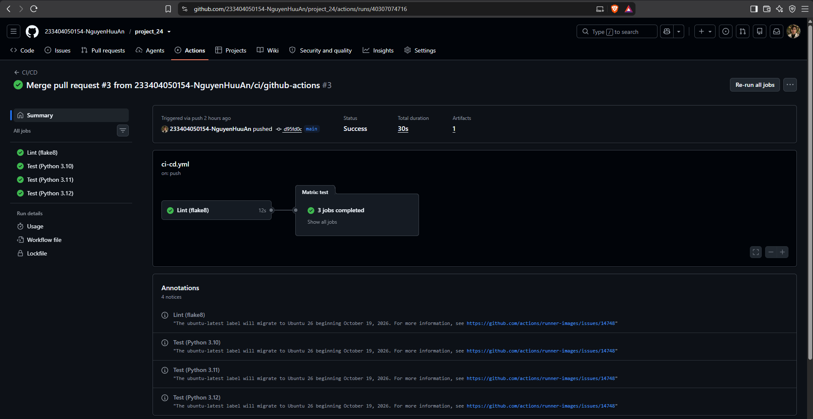

### 3.3 Làm toàn bộ trên giao diện web (không cần gõ lệnh Git)

Phù hợp khi chỉ thêm hoặc sửa một file văn bản.

1. Vào repo trên GitHub. Mở file cần sửa, bấm biểu tượng cây bút (Edit this file). Muốn thêm file mới: Add file → Create new file.
2. Sửa hoặc dán nội dung. Với file mới, gõ đường dẫn vào ô tên, ví dụ `docs/ten-file.md`.
3. Bấm **Commit changes...** (nút xanh).
4. Trong hộp thoại: nhập thông điệp commit (theo quy ước ở mục 3.2), chọn **Create a new branch for this commit and start a pull request**, rồi **Propose changes**.
5. Ở trang tiếp theo bấm **Create pull request**.
6. Chờ phần "Checks" hiện dấu tích xanh cho cả `Lint (flake8)` và ba `Test`. Nút **Merge pull request** chỉ mở khoá khi tất cả xanh.
7. Bấm **Merge pull request** → **Confirm merge**. Có thể bấm **Delete branch**.

Nếu bạn dùng cách web nhưng cũng có repo trên máy, nhớ `git switch main` và `git pull` trước khi làm việc bằng lệnh.

## 4. Lỗi thường gặp

| Dấu hiệu | Nguyên nhân | Cách xử lý |
|---|---|---|
| `git` hoặc `gh` is not recognized (không nhận ra lệnh) | Chưa cài, hoặc cài xong chưa mở lại PowerShell | Cài theo mục 1.1, đóng và mở lại PowerShell |
| `.venv\Scripts\Activate.ps1 cannot be loaded because running scripts is disabled` | PowerShell chặn script | Chạy `Set-ExecutionPolicy -Scope CurrentUser RemoteSigned` (mục 1.3), hoặc gọi `.venv\Scripts\python -m pytest ...` |
| Cửa sổ lạ mở ra lúc commit hoặc merge, có chữ `-- INSERT --` hoặc `~` ở các dòng | Git mở Vim | Bấm `Esc`, gõ `:wq` rồi Enter để lưu và thoát (hoặc `:q!` để bỏ). Đặt `git config --global core.editor notepad` để lần sau mở Notepad |
| Nhánh mới không có file workflow, CI không chạy | Nhánh được tạo từ `main` cũ | Về `main`, `git pull`, rồi tạo lại nhánh. Hoặc trên nhánh đang làm: `git merge main` |
| `refusing to allow an OAuth App to create or update workflow ... without workflow scope` | Token của `gh` thiếu quyền `workflow` | `gh auth refresh -h github.com -s workflow` (mục 1.4) |
| `Cannot prompt because user interactivity has been disabled` hoặc `could not read Username` khi push | Git chưa dùng đăng nhập của `gh` | `gh auth setup-git`, rồi push lại |
| `! [rejected] ... (fetch first)` hoặc `non-fast-forward` khi push | Nhánh trên GitHub có commit mà máy bạn chưa có | `git pull`, xử lý xung đột nếu có, rồi `git push` lại. Không dùng `--force` |
| `gh pr create` báo `Head sha can't be blank` hoặc `No commits between main and ...` | Lệnh `git push` trước đó chưa thành công nên GitHub chưa thấy nhánh | Xem lại kết quả `git push`, sửa lỗi, push lại rồi mở PR |
| `gh pr merge` báo `the base branch policy prohibits the merge` | PR chưa đủ điều kiện: CI chưa xong hoặc đang đỏ | Đúng thiết kế của ruleset (mục 5). Chờ CI xanh, hoặc sửa lỗi cho CI xanh. Không dùng `--admin` |
| Trong file xuất hiện `<<<<<<<`, `=======`, `>>>>>>>` | Xung đột (conflict): hai người sửa cùng một đoạn | Mở file, giữ phần đúng, xoá ba dòng đánh dấu; `git add <file>`; `git commit` (hoặc `git merge --continue`); `git push` |
| `warning: LF will be replaced by CRLF the next time Git touches it` | Windows và Linux xuống dòng khác nhau | Không phải lỗi, bỏ qua |
| `gh: To get started with GitHub CLI, please run: gh auth login` | `gh` chưa đăng nhập | `gh auth login` (mục 1.4) |
| `flake8` báo `E501 line too long` | Dòng dài hơn 100 ký tự | Ngắt dòng. Cấu hình ở `.flake8` |
| CI đỏ nhưng chạy trên máy thì xanh | Phiên bản Python khác (CI chạy 3.10, 3.11, 3.12) hoặc quên đẩy file | Mở log của job đỏ (mục 6) xem dòng `FAILED`; thử đúng phiên bản Python đó |

## 5. Ruleset bảo vệ nhánh main

**Làm gì:** khoá `main` để code chỉ vào được qua PR đã có CI xanh. Việc này làm đúng điều CI/CD hứa: không có thay đổi nào chưa kiểm tra mà lên được `main`, và vì deploy chỉ chạy khi có commit mới trên `main`, cũng không có bản chưa kiểm tra nào lên được web.

**Ruleset `Bao ve main` gồm:**
- Chặn xoá nhánh `main` (Restrict deletions).
- Chặn force push (Block force pushes).
- Bắt buộc đi qua PR (Require a pull request before merging), cần 0 người duyệt.
- Bắt buộc 4 check phải xanh: `Lint (flake8)`, `Test (Python 3.10)`, `Test (Python 3.11)`, `Test (Python 3.12)`. Các check này phải do GitHub Actions báo (nguồn khác không giả mạo được).
- Không ai được bỏ qua luật (danh sách bypass trống).

### 5.1 Tạo bằng giao diện web

Chỉ làm **sau khi CI đã chạy ít nhất một lần**, vì ô chọn check chỉ gợi ý các check đã từng chạy.

1. Repo → Settings → Rules → Rulesets → New ruleset → New branch ruleset.
2. Ruleset Name: `Bao ve main`. Enforcement status: **Active**.
3. Target branches → Add target → **Include default branch**.
4. Tích: Restrict deletions; Require a pull request before merging (Required approvals: 0); Block force pushes; Require status checks to pass, rồi Add checks và chọn đủ 4 check ở trên.
5. Không thêm ai vào Bypass list. Bấm **Create**.

### 5.2 Tạo bằng lệnh

Lưu nội dung JSON ở [Phụ lục A](#phụ-lục-a-json-ruleset) thành file `ruleset.json` (ngoài thư mục repo), rồi:

```powershell
gh api --method POST repos/233404050154-NguyenHuuAn/project_24/rulesets --input ruleset.json
```

Kiểm tra lại:

```powershell
gh api repos/233404050154-NguyenHuuAn/project_24/rulesets --jq '.[] | {id,name,enforcement}'
```

**Kết quả đúng:** `{"enforcement":"active","id":25872062,"name":"Bao ve main"}`.

📸 `05a_ruleset.png` và `05b_ruleset.png`: trang ruleset `Bao ve main` (trang dài nên chụp hai ảnh, ảnh a phần đầu và ảnh b phần còn lại). Đường dẫn: repo → Settings → Rules → Rulesets → `Bao ve main`.

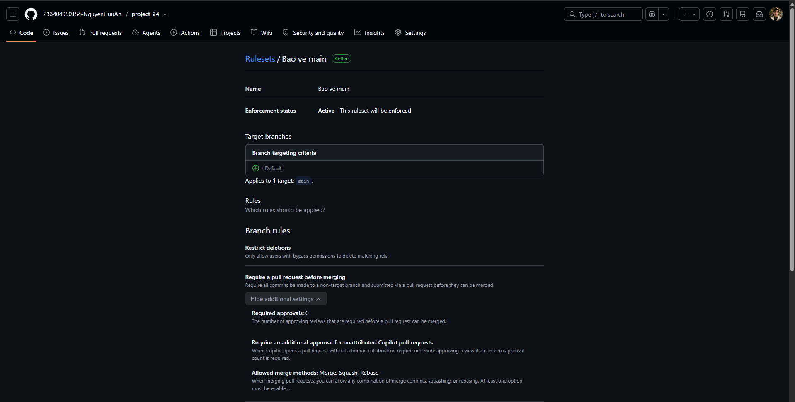

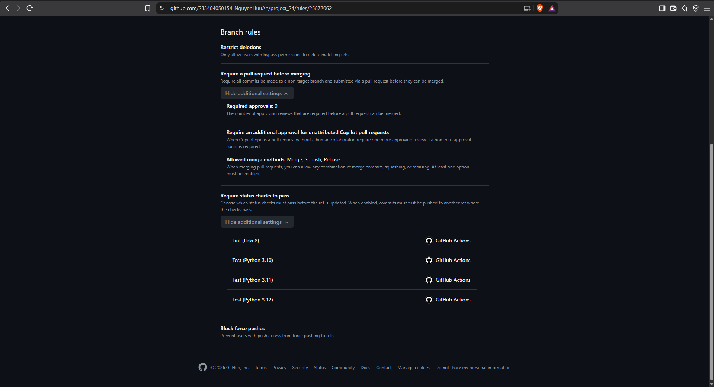

### 5.3 Ruleset chặn như thế nào (ví dụ thật)

Khi một PR có test đỏ, nút Merge bị khoá và hiện `Required` bên cạnh các check chưa đạt. Lệnh `gh pr merge --merge` cũng bị từ chối:

```
X Pull request ...#4 is not mergeable: the base branch policy prohibits the merge.
```

📸 `07_pr-bi-chan.png`: trang PR có check đỏ, nút Merge pull request bị khoá.

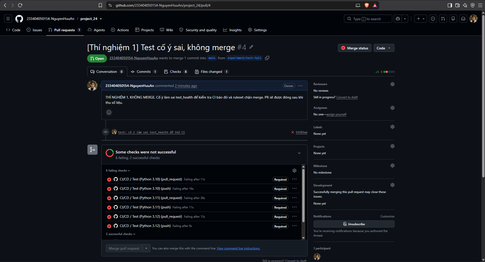

## 6. Đọc tab Actions

Vào repo → tab **Actions**. Cấu trúc từ lớn đến nhỏ:

| Khái niệm | Là gì | Nhìn ở đâu |
|---|---|---|
| Workflow | Một file `.yml` trong `.github/workflows/`, ở đây là `CI/CD` | Danh sách bên trái tab Actions |
| Run | Một lần workflow chạy, ứng với một sự kiện (push, pull_request, bấm chạy tay) | Danh sách giữa trang. Mỗi run có số, ví dụ `#13` |
| Job | Một nhóm bước chạy trên một máy ảo: `Lint (flake8)`, `Test (Python 3.10)`, ..., `Deploy (Render)` | Sơ đồ ở trang run |
| Step | Một bước trong job: checkout, cài Python, `pip install`, `pytest`... | Bấm vào job để mở danh sách bước |
| Log | Chữ in ra khi bước chạy | Bấm vào từng bước để mở |
| Artifact | File do job tạo ra và giữ lại: `coverage-report` (báo cáo độ phủ), giữ 7 ngày | Cuối trang run, mục Artifacts |

**Cách đọc nhanh một run:**
1. Nhìn biểu tượng: ✅ xanh, ❌ đỏ, vòng tròn vàng đang chạy, dấu gạch là bị bỏ qua.
2. Ở sơ đồ, `Lint` chạy trước. Chỉ khi Lint xanh thì ba `Test` mới chạy (song song). `Deploy (Render)` chỉ chạy khi cả ba Test xanh **và** run đó là push vào `main`.
3. Run đỏ: bấm vào job có dấu ❌ → mở bước có dấu ❌ → đọc những dòng cuối. Với test hỏng, tìm dòng bắt đầu bằng `FAILED` hoặc `E   AssertionError`. Ví dụ thật ở thí nghiệm 1: `FAILED tests/test_app.py::test_health - AssertionError`.
4. Thời gian từng job nằm cạnh tên job (ví dụ `Lint (flake8) 15s`) và tổng thời gian ở đầu trang (`Total duration 49s`).

Xem bằng lệnh:

```powershell
gh run list --limit 5                      # các run gần nhất
gh run view <id-run> --json jobs           # job và thời gian
gh run view <id-run> --log                 # toàn bộ log
gh run view <id-run> --log-failed          # chỉ log của bước đỏ
```

**Hai run cho một lần đẩy.** Khi nhánh đã có PR, mỗi lần đẩy commit sinh hai run: một run do sự kiện `push`, một run do `pull_request`. Kết quả giống nhau nhưng tốn gấp đôi thời gian chạy. Đây là hệ quả của cấu hình `on:` đang dùng.

**Caches.** Tab Actions → Caches liệt kê cache pip (mỗi phiên bản Python một cache, khoảng 4 đến 5 MB). Xem và xoá bằng lệnh:

```powershell
gh cache list
gh cache delete --all
```

📸 `06_ci-do.png`: trang run đỏ, Lint xanh còn Test đỏ.

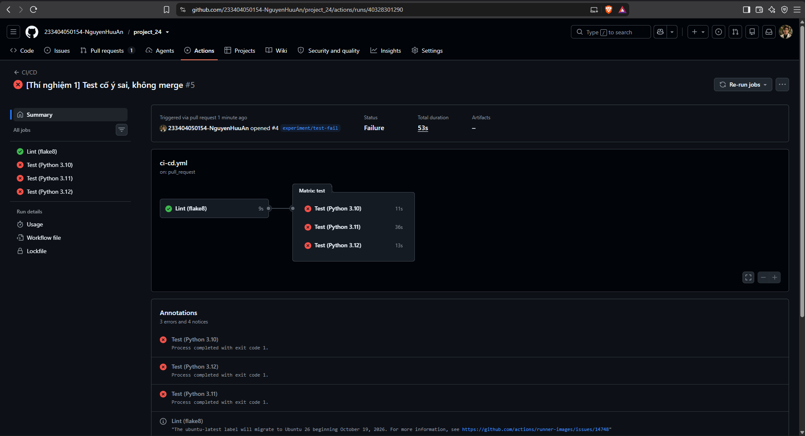

## 7. Render: tạo Web Service

Render là dịch vụ chạy ứng dụng web (PaaS): ta đưa code, Render lo máy chủ, HTTPS và địa chỉ. Gói **Free** đủ cho đề tài. Phần này làm trên web, không làm bằng lệnh.

**Giới hạn của gói Free** (trang render.com/docs/free, truy cập ngày 26/10/2026):
- Ngừng chạy sau 15 phút không có truy cập. Mở lại mất thời gian khởi động. Nhóm đo hai lần được **22,6 giây**, trong khi Render ghi "khoảng một phút".
- 750 giờ instance miễn phí mỗi tháng cho mỗi workspace.
- Hệ thống file bị xoá mỗi lần deploy, restart hoặc ngủ. Vì ứng dụng lưu dữ liệu trong bộ nhớ, dữ liệu mất theo. Dùng nút Xuất/Nhập JSON để sao lưu.

### 7.1 Tạo Web Service

1. Vào https://dashboard.render.com, đăng nhập (có thể bằng tài khoản GitHub).
2. **New** → **Web Service**. Kết nối GitHub và chọn repo `project_24` (chỉ cấp quyền cho repo này).
3. Điền:

| Ô | Giá trị |
|---|---|
| Name | `project-24` (địa chỉ có dạng `https://project-24-xxxx.onrender.com`; hậu tố do Render tự thêm) |
| Region | Singapore (gần Việt Nam nhất) |
| Branch | `main` |
| Runtime | Python 3 |
| Build Command | `pip install -r requirements.txt` |
| Start Command | `gunicorn app:app` |
| Instance Type | **Free** |

Không đặt biến môi trường nào. Phiên bản Python lấy từ file `.python-version` trong repo (Render dùng bản vá mới nhất của 3.12; lần deploy gần nhất dùng 3.12.15). Gunicorn mặc định chạy 1 worker, đúng với giả định lưu dữ liệu trong bộ nhớ.

4. Bấm tạo. Render tự deploy lần đầu. Chờ trạng thái **Live** rồi mở địa chỉ, phải thấy ứng dụng.

📸 `11_web-render-v1.png`: web trên Render, bản đầu (ví dụ `v1.0.0`), chụp cả thanh địa chỉ.

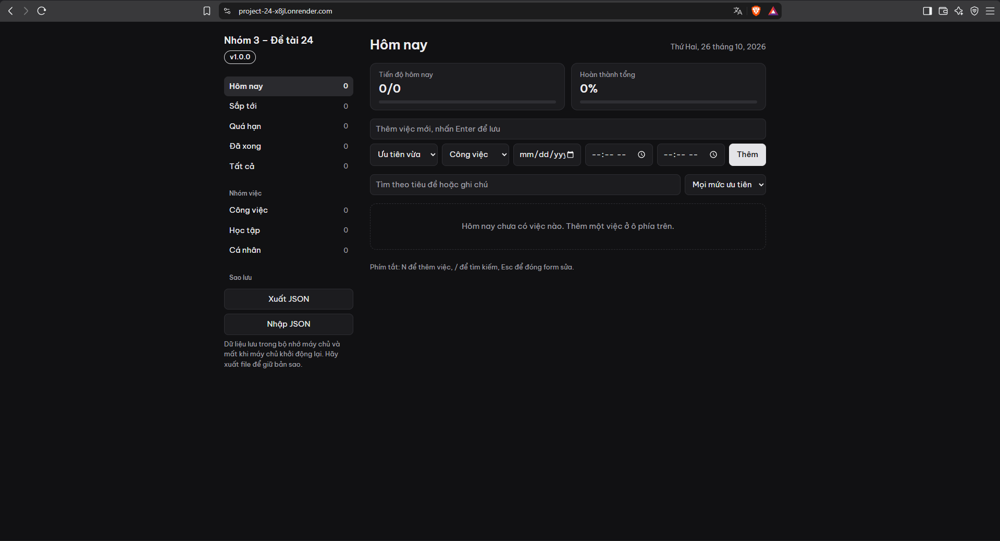

### 7.2 Tắt Auto-Deploy

Mặc định Render tự deploy mỗi khi có commit mới trên nhánh. Ta tắt để **chỉ pipeline mới được deploy** (sau khi qua test).

Vào service → **Settings** → mục **Deploy** → **Auto-Deploy** → chọn **Off**.

### 7.3 Lấy Deploy Hook

Cũng trong **Settings** → mục **Deploy** → **Deploy Hook**. Đây là một địa chỉ bí mật: ai gửi yêu cầu `POST` tới nó là Render deploy. Bấm biểu tượng sao chép. **Không dán vào chat, file, commit.** Nếu nghi bị lộ, bấm **Regenerate hook** để đổi.

📸 `08a_render-cau-hinh.png` và `08b_render-cau-hinh.png`: trang Settings, ảnh a thấy Build Command, ảnh b thấy Start Command, Auto-Deploy = Off và ô Deploy Hook **đang bị che** (chỉ thấy dấu chấm). Kiểm tra kỹ ảnh không hiện giá trị hook.

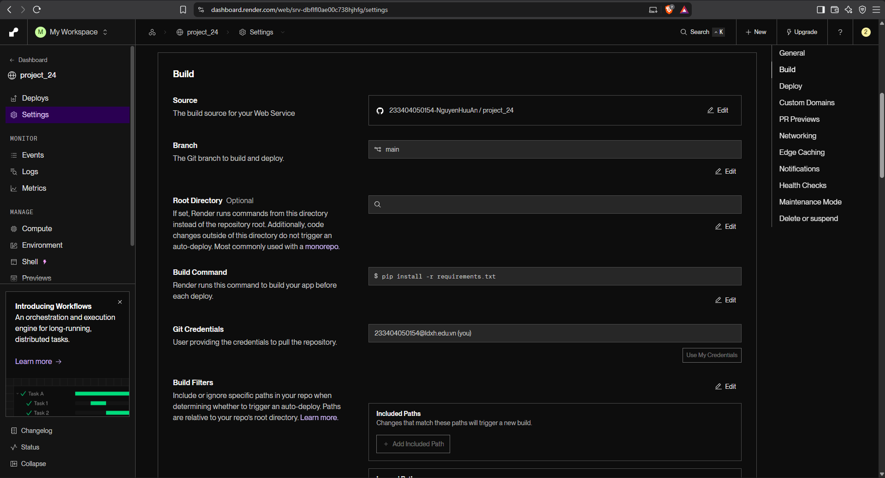

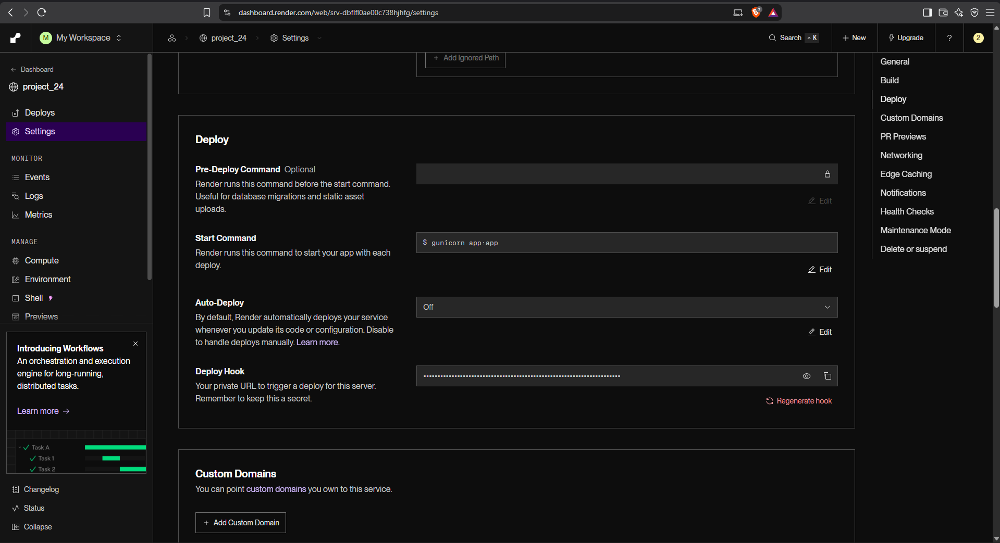

## 8. Secrets và Variables

Pipeline cần hai thông tin để gọi Render:

| Tên | Loại | Nội dung | Vì sao loại này |
|---|---|---|---|
| `RENDER_DEPLOY_HOOK` | **Secret** | Địa chỉ Deploy Hook | Bí mật. Secret được mã hoá, không xem lại được, và bị che thành `***` trong log |
| `RENDER_APP_URL` | **Variable** | Địa chỉ web, ví dụ `https://project-24-x8jl.onrender.com` (không có dấu `/` ở cuối) | Không bí mật, cần đọc lại được |

**Đặt bằng lệnh** (chạy trong PowerShell của bạn, thư mục `project_24`):

```powershell
gh secret set RENDER_DEPLOY_HOOK
gh variable set RENDER_APP_URL --body "https://<dia-chi-that>.onrender.com"
```

Lệnh đầu hỏi giá trị: dán Deploy Hook (không hiện ra màn hình) rồi Enter. **Không gõ giá trị bí mật vào chính dòng lệnh, không gửi qua chat.**

**Hoặc trên web:** repo → Settings → Secrets and variables → Actions. Tab Secrets → New repository secret (đặt tên và dán giá trị). Tab Variables → New repository variable.

**Kiểm tra** (chỉ thấy tên, không thấy giá trị bí mật):

```powershell
gh secret list
gh variable list
```

**Kết quả đúng:**

```
RENDER_DEPLOY_HOOK   2026-10-26T13:46:03Z
RENDER_APP_URL       https://project-24-x8jl.onrender.com   2026-10-26T13:47:08Z
```

**Môi trường `production`:** job `deploy` khai báo `environment: production`. GitHub tự tạo môi trường này ở lần chạy đầu và hiện link web ngay trên trang run. Hiện môi trường chưa có luật duyệt thủ công.

**Lưu ý bảo mật:** secret không được truyền cho workflow chạy từ PR của một bản fork (trang Secrets của GitHub ghi rõ điều này, xem ảnh 09a). Người có quyền ghi vào repo vẫn có thể viết workflow dùng secret, nên chỉ mời người tin cậy.

📸 `09a_secrets-variables.png` và `09b_secrets-variables.png`: ảnh a là tab Secrets (thấy tên `RENDER_DEPLOY_HOOK`), ảnh b là tab Variables (thấy `RENDER_APP_URL` và địa chỉ web). Đường dẫn: repo → Settings → Secrets and variables → Actions.

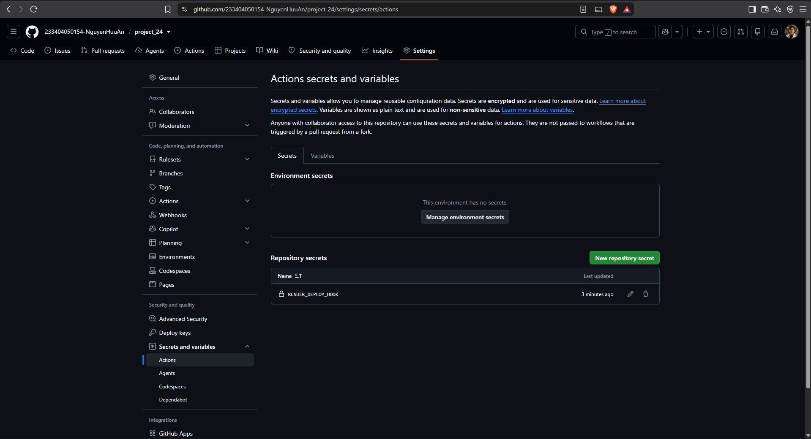

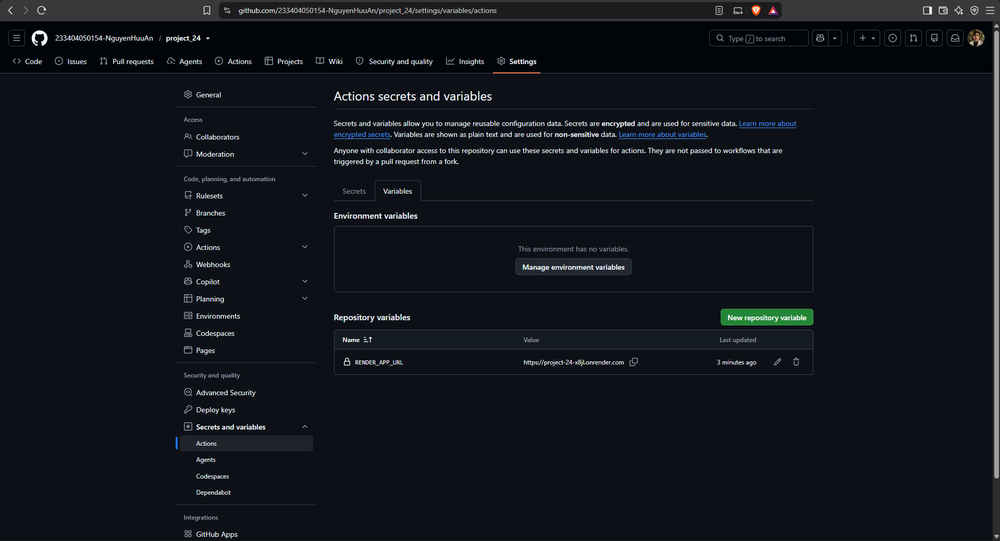

## 9. Luồng CI/CD đầy đủ

Tình huống: muốn tạo "bản mới" của ứng dụng. Ta đổi số `APP_VERSION` trong `app.py` (ví dụ từ `1.0.0` sang `1.1.0`) và để pipeline làm phần còn lại.

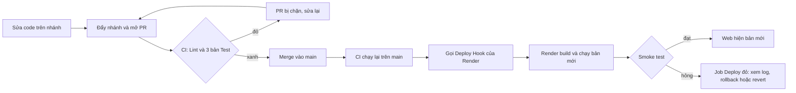

> Ghi chú cho báo cáo: sơ đồ trên chỉ hiện trên GitHub. Khi đưa vào file Word hoặc slide, cần xuất thành ảnh PNG (hoặc vẽ lại bằng công cụ vẽ sơ đồ) và đánh số "Hình x.y".

**Từng bước:**

1. **Sửa code và mở PR** (mục 3.2). Ví dụ thật: PR #7 đổi `APP_VERSION` từ `1.0.0` sang `1.1.0`.
2. **CI chạy trên PR:** Lint rồi ba Test. Ở PR #7 (run do sự kiện push): Lint 11 giây, Test 3.10 mất 18 giây, 3.11 mất 11 giây, 3.12 mất 14 giây.
3. **Merge.** GitHub tạo commit merge trên `main`.
4. **CI chạy lại trên `main`** (sự kiện push), và vì đây là push vào `main`, job `Deploy (Render)` chạy sau khi cả ba Test xanh.
5. **Job Deploy gọi Deploy Hook.** Render nhận lệnh, kéo code mới, build (`pip install`), khởi động Gunicorn. Trong lúc đó web vẫn trả bản cũ.
6. **Smoke test** (bài kiểm tra nhanh sau deploy): cứ 15 giây gọi `/health` một lần, tối đa 40 lần (khoảng 10 phút), cho tới khi `version` trả về bằng `APP_VERSION` trong code vừa merge. Sau đó kiểm tra tiếp trang chủ `/` trả HTTP 200 và mọi file trong `<script src>` và `<link href>` cùng máy chủ cũng trả 200. Tất cả đạt thì job xanh.
7. **Web hiện bản mới.** Huy hiệu phiên bản ở giao diện đổi sang `v1.1.0`.

**Số liệu thật của lần này** (run `40336031610`): Lint 11 giây, Test 13, 13 và 17 giây, Deploy 56 giây (gọi hook 1 giây, smoke test 51 giây với 4 lần thử: ba lần đầu thấy `1.0.0`, lần bốn thấy `1.1.0`), cả run 93 giây.

**Hạn chế đã đo, cần biết khi trình bày:**
- Nếu commit không đổi `APP_VERSION`, smoke test đạt ngay lập tức trên bản cũ còn đang chạy (Deploy chỉ 6 đến 8 giây), nên không chứng minh được Render đã build lại. Smoke test chỉ có giá trị khi version đổi.
- Smoke test chạy **sau** khi gọi Deploy Hook, nên một bản lỗi vẫn lên web trong lúc chờ. Smoke test giúp **phát hiện** chứ không **chặn**. Việc chặn trước khi merge do CI làm (ví dụ test `test_index_static_files_exist` bắt lỗi gõ sai tên file tĩnh).

📸 `10_pipeline-deploy-xanh.png`: trang run có Lint → Test → Deploy (Render) đều xanh. Ảnh dùng run của PR #6 (lần deploy đầu tiên, `Deploy (Render)` 7 giây, kèm link `production`).

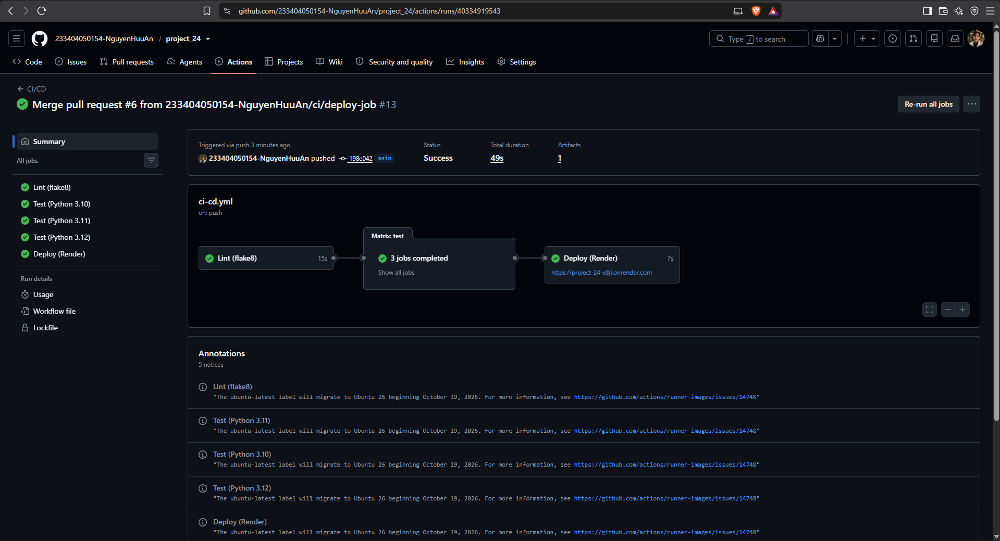

📸 `12_web-render-v2.png`: web trên Render sau khi đổi version (`v1.1.0`).

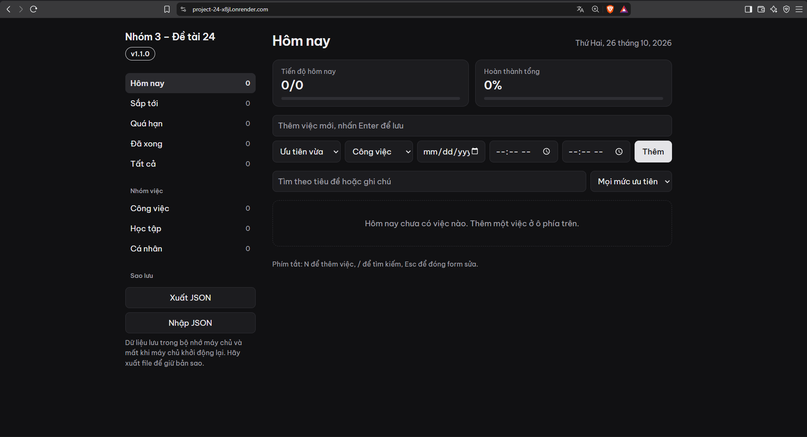

**Video demo (2 đến 3 phút):** sửa version, PR, CI xanh, merge, deploy, web đổi phiên bản. Quay bằng Xbox Game Bar (`Win+Alt+R`) hoặc OBS. Link: https://drive.google.com/file/d/1kUIelZABz_gtzm_IreyU2uQ35SYCu4WR/view?usp=sharing

## 10. Kịch bản từng thí nghiệm

Mỗi thí nghiệm dưới đây làm lại được. Số liệu thật của nhóm nằm trong `docs/thi-nghiem.md`. Mọi thay đổi vào `main` vẫn đi qua PR.

> **Cảnh báo chung:** thí nghiệm 4 làm giao diện web trên Render hỏng vài phút. Thí nghiệm 6 (cold start) cần máy không ngủ và không ai mở web trong khoảng 40 phút. Báo cho cả nhóm trước khi làm, và đừng làm lúc đang demo hay chụp ảnh web.

### Thí nghiệm 1: test đỏ thì CI đỏ, PR bị chặn và web giữ bản cũ

**Mục đích:** kiểm tra một thay đổi làm hỏng test không vào được `main`.

```powershell
git switch main; git pull
git switch -c experiment/test-fail
# Sửa 1 dòng trong tests\test_app.py: ở test_health, đổi version kỳ vọng thành "0.0.0"
git add tests; git commit -m "test: cố ý làm sai test_health để thử CI"
git push -u origin experiment/test-fail
gh pr create --base main --title "[Thí nghiệm 1] Test cố ý sai, không merge" --body "Không merge"
gh pr checks --watch                  # kỳ vọng: Lint pass, 3 Test fail
gh pr view --json mergeStateStatus    # kỳ vọng: BLOCKED
gh pr merge --merge                   # kỳ vọng: bị từ chối (chỉ chạy khi PR còn đỏ)
git revert HEAD --no-edit             # hoàn tác commit sai
git push                              # CI xanh, mergeStateStatus thành CLEAN
gh pr close --delete-branch --comment "Thí nghiệm kết thúc, không merge."
```

**Kết quả mong đợi:** Lint xanh (khoảng 9 giây), 3 Test đỏ, `1 failed, 74 passed`; lệnh merge bị từ chối với `the base branch policy prohibits the merge`. Sau khi revert, CI xanh. Ảnh `06_ci-do.png`, `07_pr-bi-chan.png`.

**Phần deploy:** đẩy một nhánh có test sai và `APP_VERSION` khác (chỉ push, không mở PR). Kỳ vọng: job Deploy `skipped` và `curl <địa-chỉ-web>/health` vẫn trả version cũ. Xoá nhánh sau đó: `git push origin --delete <nhánh>`.

### Thí nghiệm 2: có và không có cache pip

**Mục đích:** đo cache pip rút ngắn bao nhiêu thời gian.

```powershell
gh cache delete --all                                  # xoá cache: lần chạy "không cache"
gh workflow run ci-cd.yml --ref main                   # chạy workflow (sự kiện workflow_dispatch)
gh run list --workflow ci-cd.yml --limit 1             # lấy id run vừa tạo
gh run watch <id-run>                                  # chờ run xong
gh run view <id-run> --json jobs                       # thời gian từng job và từng bước
```

Lặp lại 5 lần với `gh cache delete --all` trước mỗi lần (không cache), rồi 5 lần liên tiếp không xoá (có cache). Job `deploy` tự bỏ qua vì sự kiện không phải push. Xác nhận hit hay miss trong log `setup-python`: `Cache restored successfully` (hit) hoặc `pip cache is not found` (miss).

**Lưu ý:** job `Test (Python 3.12)` luôn là hit vì nó chạy sau khi `Lint` (cùng Python 3.12) đã lưu cache. **Kết quả đã đo:** cả run 37,8 giây (không cache) so với 33,2 giây (có cache), chênh khoảng 4,6 giây, nhỏ hơn hoặc ngang độ dao động giữa các lần.

### Thí nghiệm 3: deploy thủ công và deploy tự động

**Mục đích:** so sánh số bước, thời gian và khả năng sai sót.

**Tự động:** đã làm ở mục 9; lấy thời gian từ log bước Smoke test (`gh run view <id-run> --log`).

**Thủ công (làm trên Render):**
1. Mở dashboard Render, chọn service.
2. Bấm **Manual Deploy** → **Deploy latest commit**.
3. Chờ trạng thái **Live** và ghi lại giờ bấm, giờ Live (tab Events).
4. Mở web kiểm tra phiên bản.

Trước khi bấm, tạo một việc bất kỳ trên web: dữ liệu nằm trong bộ nhớ nên việc này biến mất đúng lúc bản mới chạy, dùng làm mốc khách quan. Đo `flake8` và `pytest` trên máy bằng `Measure-Command { flake8 }` (đây là hai việc người deploy thủ công phải tự nhớ làm).

**Kết quả đã đo:** thủ công 6 bước, 48,6 giây từ lúc bấm đến khi live. Tự động 0 bước sau merge, 52 đến 111 giây từ lúc gọi hook đến khi thấy bản mới (3 mẫu). Deploy tự động không nhanh hơn, giá trị của nó là kiểm soát và dấu vết.

### Thí nghiệm 4: rollback

**Mục đích:** đo thời gian khôi phục khi một lỗi lọt qua CI và đã lên web, bằng `git revert` và bằng Rollback của Render.

**Gây lỗi** (lỗi gõ sai tên file script, test cũ và smoke test cũ đều không bắt được):

```powershell
git switch main; git pull
git switch -c experiment/bad-asset
# Trong templates\index.html đổi filename='app.js' thành filename='app.jss'
git add templates; git commit -m "feat: đổi tên file script (lỗi cố ý)"
git push -u origin experiment/bad-asset
gh pr create --base main --title "[Thí nghiệm 4] Sai tên file script" --body "Lỗi cố ý"
```

Từ khi có test `test_index_static_files_exist`, **CI sẽ đỏ** ở bước này và PR bị chặn, nên không merge được. Để làm lại đúng thí nghiệm gốc (lỗi lọt qua), phải làm trên bản code chưa có test đó, hoặc chấp nhận quan sát CI đỏ như một kết quả thay thế.

**Kiểm tra web hỏng** (không cần mở trình duyệt):

```powershell
curl.exe -s -o NUL -w "%{http_code}`n" https://<dia-chi-web>/static/app.jss     # 404 khi web hỏng
curl.exe -s -o NUL -w "%{http_code}`n" https://<dia-chi-web>/static/app.js      # 200 khi web khoẻ
```

**Khôi phục bằng `git revert`:**

```powershell
git switch main; git pull
git switch -c revert/bad-asset
git revert -m 1 <ma-commit-merge-cua-PR-loi>     # -m 1 vì đây là commit merge
git push -u origin revert/bad-asset
gh pr create --base main --title "Revert: hoàn tác PR loi" --body "Hoàn tác"
gh pr checks --watch
gh pr merge --merge --delete-branch
```

**Khôi phục bằng Rollback của Render** (làm trên web): service → **Deploys** → chọn một deploy thành công gần đây → **Rollback** → **Rollback to this deploy**. Render dùng lại bản build cũ nên không build lại. Rollback trên dashboard còn tự tắt Auto-Deploy (đã tắt sẵn, không bật lại).

**Kết quả đã đo:** `git revert` mất 1 phút 32 giây tính từ lúc merge revert (2 phút 19 giây tính từ lúc mở PR revert). Rollback mất khoảng 25 giây mỗi lượt. Điểm khác quan trọng: Rollback không để lại dấu vết trong repo và có thể làm web lệch khỏi `main` (đo được khoảng 2 phút 16 giây web chạy bản lỗi trong khi `main` đã là bản tốt); `git revert` luôn giữ web khớp với `main`.

**Cải tiến sau thí nghiệm:** smoke test kiểm tra file tĩnh (mục 9) và test `test_index_static_files_exist` trong `tests/test_app.py`. Chạy lại lỗi `app.jss` kèm đổi version lên `1.1.1` làm job Deploy đỏ ở smoke test (`/static/app.jss` trả 404), sau merge 2 phút 31,7 giây.

### Thí nghiệm 5: bảo mật

**Mục đích:** kiểm tra secret bị che, quyền tối thiểu, và hạn chế với PR từ fork. Chỉ đọc, không tạo thêm run in secret.

```powershell
# Secret bị che trong log: phải thấy RENDER_DEPLOY_HOOK: ***
gh run view <id-run-deploy> --log | Select-String "RENDER_DEPLOY_HOOK"
# Quyền của GITHUB_TOKEN: phải thấy Contents: read và Metadata: read
gh run view <id-run> --log | Select-String "GITHUB_TOKEN Permissions" -Context 0,3
# Quyền mặc định của token và quy định duyệt workflow từ người ngoài
gh api repos/233404050154-NguyenHuuAn/project_24/actions/permissions/workflow
gh api repos/233404050154-NguyenHuuAn/project_24/actions/permissions/fork-pr-contributor-approval
```

**Kết quả đã đo:** `RENDER_DEPLOY_HOOK: ***` trong log; token chỉ có `Contents: read` và `Metadata: read`; quyền mặc định là `read`; chính sách fork là `first_time_contributors`. Tài liệu GitHub ghi: "With the exception of `GITHUB_TOKEN`, secrets are not passed to the runner when a workflow is triggered from a forked repository." Rủi ro còn lại (chưa xử lý): action ghim theo tag chứ không theo mã SHA; Deploy Hook là secret cấp repo; môi trường `production` chưa có luật duyệt.

### Thí nghiệm 6: chi phí và giới hạn

**Phút Actions.** Tính từ các run (API billing cần quyền `user` mà `gh` thường không có): cộng thời gian từng job, làm tròn lên từng phút. Xem thêm trang https://github.com/settings/billing/usage. Repo công khai dùng runner tiêu chuẩn thì miễn phí; đã đo 45 run, 188 job, 190 phút (làm tròn lên từng job). Chi phí ở đây là thời gian chờ chứ không phải tiền.

📸 `13_actions-usage.png`: trang Usage của GitHub (thấy Billed $0,00).

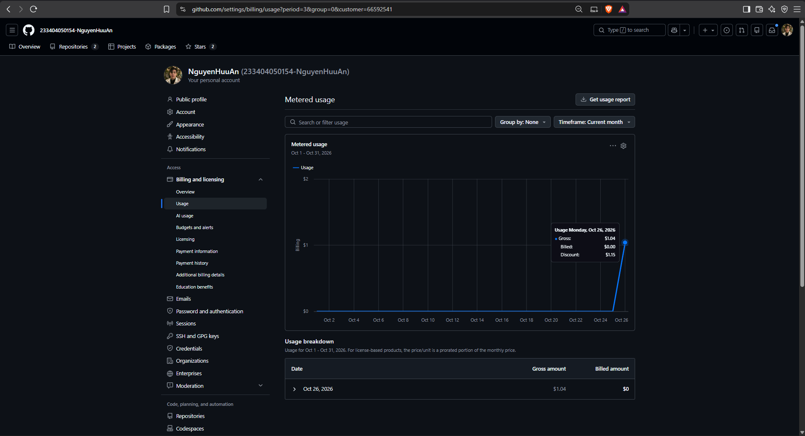

**Cold start Render Free.** Chuẩn bị: **tắt chế độ ngủ của máy** (Settings → System → Power), và không ai mở web trong lúc đo. Chờ 18 phút không truy cập (Render ngủ sau 15 phút), rồi:

```powershell
curl.exe --max-time 120 -s -o NUL -w "%{http_code} ttfb=%{time_starttransfer} total=%{time_total}`n" https://<dia-chi-web>/health   # lần đầu (cold)
curl.exe --max-time 120 -s -o NUL -w "%{http_code} ttfb=%{time_starttransfer} total=%{time_total}`n" https://<dia-chi-web>/health   # lần hai (nóng)
```

Lặp nhiều chu kỳ, mỗi chu kỳ lại chờ 18 phút. **Kết quả đã đo** (2 chu kỳ): lần đầu 22,55 và 22,65 giây, các lần sau khoảng 0,27 giây.

## 11. Bảng ảnh chụp

Lưu vào `docs/minh-chung/`, tên đúng như bảng. Chụp cả thanh địa chỉ, zoom 100 đến 125%, **che mọi giá trị bí mật** (đặc biệt Deploy Hook). Cột thứ ba chỉ ảnh dùng cho mục nào của báo cáo (theo dàn ý: chương 3 là thiết kế và triển khai, chương 4 là kết quả và đánh giá).

| Ảnh | Nội dung | Dùng cho mục nào của báo cáo | Trạng thái |
|---|---|---|---|
| `01_repo-moi.png` | Trang chủ repo vừa tạo | Chương 3, cấu hình GitHub | Đã có |
| `02_pytest-xanh.png` | flake8 và pytest trên máy, coverage 100% | Chương 3, ứng dụng và kiểm thử | Đã có |
| `03_app-local.png` | Ứng dụng chạy local, thấy huy hiệu phiên bản | Chương 3, mô tả ứng dụng | Đã có |
| `04_actions-ci-xanh.png` | Run CI: Lint → 3 Test xanh, có thời gian | Chương 3, mục CI | Đã có |
| `05a_ruleset.png`, `05b_ruleset.png` | Ruleset `Bao ve main` (2 ảnh vì trang dài) | Chương 3, bảo vệ nhánh; chương 4, bảo mật | Đã có |
| `06_ci-do.png` | Run đỏ (Lint xanh, Test đỏ) | Chương 4, thí nghiệm 1 | Đã có |
| `07_pr-bi-chan.png` | PR có check đỏ, nút Merge bị khoá | Chương 4, thí nghiệm 1 | Đã có |
| `08a_render-cau-hinh.png`, `08b_render-cau-hinh.png` | Render Settings: build, start, Auto-Deploy Off (Deploy Hook đã che) | Chương 3, cấu hình Render | Đã có |
| `09a_secrets-variables.png`, `09b_secrets-variables.png` | GitHub Secrets và Variables (chỉ thấy tên secret) | Chương 3, cấu hình GitHub; chương 4, bảo mật | Đã có |
| `10_pipeline-deploy-xanh.png` | Run Lint → Test → Deploy xanh | Chương 3, mục CD; chương 4, thí nghiệm 3 | Đã có |
| `11_web-render-v1.png` | Web trên Render, bản đầu | Chương 3, mục CD | Đã có |
| `12_web-render-v2.png` | Web trên Render sau khi đổi version | Chương 3, mục CD; chương 4, thí nghiệm 3 | Đã có |
| `13_actions-usage.png` | Trang Usage của Actions | Chương 4, chi phí | Đã có |
| Video 2 đến 3 phút | Sửa version, PR, CI, merge, deploy, web đổi phiên bản | Phụ lục báo cáo, demo thuyết trình | Đã quay; [xem video](https://drive.google.com/file/d/1kUIelZABz_gtzm_IreyU2uQ35SYCu4WR/view?usp=sharing) |

**Ảnh nên chụp bằng cách nào:** dùng công cụ chụp của Windows (`Win+Shift+S`), chọn vùng gồm cả thanh địa chỉ, lưu thành PNG. Với trang dài (như ruleset), cuộn và chụp thành hai ảnh `a` và `b`. Trước khi đưa ảnh lên repo, mở lại ảnh để chắc không lộ giá trị bí mật.

## Phụ lục A: JSON ruleset

Dùng cho lệnh ở mục 5.2. `integration_id: 15368` là ứng dụng GitHub Actions, nghĩa là các check phải do GitHub Actions báo.

```json
{
  "name": "Bao ve main",
  "target": "branch",
  "enforcement": "active",
  "conditions": {"ref_name": {"include": ["~DEFAULT_BRANCH"], "exclude": []}},
  "bypass_actors": [],
  "rules": [
    {"type": "deletion"},
    {"type": "non_fast_forward"},
    {"type": "pull_request", "parameters": {
      "required_approving_review_count": 0,
      "dismiss_stale_reviews_on_push": false,
      "require_code_owner_review": false,
      "require_last_push_approval": false,
      "required_review_thread_resolution": false}},
    {"type": "required_status_checks", "parameters": {
      "strict_required_status_checks_policy": false,
      "required_status_checks": [
        {"context": "Lint (flake8)", "integration_id": 15368},
        {"context": "Test (Python 3.10)", "integration_id": 15368},
        {"context": "Test (Python 3.11)", "integration_id": 15368},
        {"context": "Test (Python 3.12)", "integration_id": 15368}]}}
  ]
}
```

## Phụ lục B: giải thích file workflow

File `.github/workflows/ci-cd.yml`. Phần này giúp ôn trả lời phản biện.

| Khối | Ý nghĩa |
|---|---|
| `name: CI/CD` | Tên workflow, hiện ở tab Actions |
| `on:` | Khi nào chạy: `push` (đẩy lên mọi nhánh), `pull_request` (PR vào `main`), `workflow_dispatch` (bấm chạy tay hoặc `gh workflow run`) |
| `permissions: contents: read` | Token `GITHUB_TOKEN` chỉ được đọc code. Nguyên tắc quyền tối thiểu: nếu một bước bị lợi dụng cũng không ghi được gì vào repo |
| `concurrency` | Trên cùng một nhánh, run mới huỷ run cũ đang chạy dở để tiết kiệm thời gian. Riêng `main` không huỷ, để mọi commit vào `main` đều được kiểm tra và deploy đủ |
| `jobs.lint` | Chạy `flake8` kiểm kiểu code. Chạy trước và nhanh nhất (khoảng 10 giây) |
| `jobs.test` + `needs: lint` | Chỉ chạy khi Lint xanh, nên Lint đỏ thì không tốn thời gian chạy test |
| `strategy.matrix` | Chạy cùng một job trên 3 phiên bản Python (3.10, 3.11, 3.12), song song |
| `fail-fast: false` | Một phiên bản lỗi không làm huỷ các phiên bản còn lại, nên thấy hết lỗi trong một lần chạy |
| `cache: pip` | Lưu gói pip theo nội dung `requirements*.txt` để lần sau cài nhanh hơn (đo ở thí nghiệm 2: tiết kiệm vài giây) |
| `pytest --cov ...` | Chạy test và đo độ phủ (coverage), xuất báo cáo HTML |
| `upload-artifact` | Lưu `htmlcov/` thành artifact `coverage-report` (chỉ ở bản 3.12 cho khỏi trùng, giữ 7 ngày) |
| `jobs.deploy` + `needs: test` | Chỉ chạy sau khi cả ba Test xanh |
| `if: github.event_name == 'push' && github.ref == 'refs/heads/main'` | Chỉ deploy khi push vào `main`, không deploy cho PR hay nhánh khác. Vì vậy job này không nằm trong các check bắt buộc của ruleset |
| `timeout-minutes: 15` | Giới hạn thời gian cả job, phòng khi Render treo |
| `environment` có `url` | Gắn job với môi trường `production`, hiện link web trên trang run |
| Bước gọi Deploy Hook | `curl -X POST` tới địa chỉ lấy từ secret. Dùng `--silent` và `-o /dev/null` nên không in gì; GitHub tự che giá trị secret thành `***` trong log |
| Bước Smoke test | Lặp tối đa 40 lần cách nhau 15 giây: `/health` phải trả `version` bằng `APP_VERSION` trong code; rồi `/` phải trả 200; rồi mọi file tĩnh cùng máy chủ phải trả 200 |

Các action chính thức dùng: `actions/checkout@v7`, `actions/setup-python@v7`, `actions/upload-artifact@v7` (ghim theo bản chính, kiểm tra ngày 26/10/2026).

## Phụ lục C: bảng lệnh nhanh

**Git**

| Lệnh | Việc làm |
|---|---|
| `git status` | Xem file nào đã đổi, đang ở nhánh nào |
| `git diff` | Xem nội dung thay đổi chưa ghi commit |
| `git switch <nhánh>` | Chuyển nhánh |
| `git switch -c <nhánh>` | Tạo nhánh mới và chuyển sang |
| `git add <file>` | Chọn file đưa vào commit (`git add .` là tất cả thay đổi) |
| `git commit -m "feat: ..."` | Ghi commit |
| `git push -u origin <nhánh>` | Đẩy nhánh lên GitHub (lần đầu) |
| `git pull` | Kéo bản mới của nhánh hiện tại |
| `git log --oneline -5` | Xem 5 commit gần nhất |
| `git revert <commit>` | Tạo commit hoàn tác một commit |
| `git revert -m 1 <commit-merge>` | Hoàn tác một commit merge |

**GitHub CLI (`gh`)**

| Lệnh | Việc làm |
|---|---|
| `gh auth status` | Kiểm tra đăng nhập |
| `gh pr create --base main --title "..." --body "..."` | Mở PR |
| `gh pr checks --watch` | Chờ và xem kết quả CI của PR |
| `gh pr view --json mergeStateStatus` | Xem PR đã merge được chưa (`CLEAN`) hay đang bị chặn (`BLOCKED`) |
| `gh pr merge --merge --delete-branch` | Merge và xoá nhánh |
| `gh pr close <số> --delete-branch` | Đóng PR không merge |
| `gh run list --limit 5` | Các run gần nhất |
| `gh run view <id> --log` | Log của một run |
| `gh workflow run ci-cd.yml --ref main` | Chạy workflow bằng tay |
| `gh cache list` / `gh cache delete --all` | Xem và xoá cache |
| `gh secret list` / `gh variable list` | Xem tên secret và variable |

**Kiểm tra web bằng `curl.exe`** (trong PowerShell phải gõ `curl.exe`, vì `curl` là bí danh của lệnh khác)

| Lệnh | Việc làm |
|---|---|
| `curl.exe -s https://<web>/health` | Xem trạng thái và phiên bản |
| `curl.exe -s -o NUL -w "%{http_code}" https://<web>/static/app.js` | Xem mã HTTP của một file |
